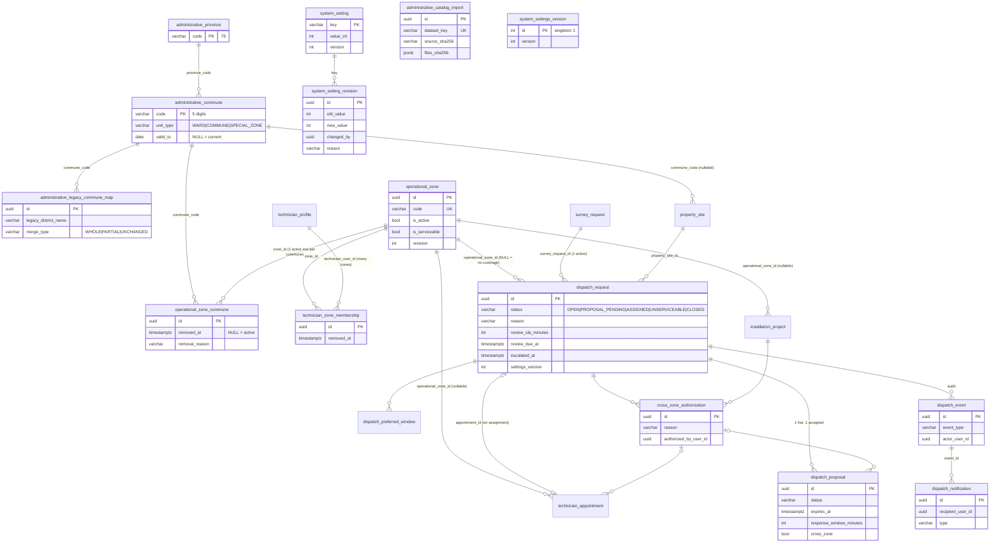

# Database migration — administrative locations, operational zones, dispatch and settings

Migration: `20261020051352_AdministrativeLocationsZonesDispatchAndSettings` (after `20261016161547_BusinessRulesFlow1And2Redesign`).
Status: **generated and rehearsed locally only. NOT applied to Supabase Dev.** Applying it needs explicit approval.

Related guides: [administrative-locations-and-zones.md](administrative-locations-and-zones.md),
[dispatch-and-uncovered-zones.md](dispatch-and-uncovered-zones.md), [system-settings.md](system-settings.md),
[supabase-security.md](supabase-security.md), [deployment-readiness.md](deployment-readiness.md).

## 1. What it changes

| Kind | Objects |
|---|---|
| New tables (16, all with RLS enabled, no policies) | `administrative_province`, `administrative_commune`, `administrative_legacy_commune_map`, `administrative_catalog_import`, `operational_zone`, `operational_zone_commune`, `technician_zone_membership`, `dispatch_request`, `dispatch_preferred_window`, `dispatch_proposal`, `dispatch_event`, `dispatch_notification`, `cross_zone_authorization`, `system_setting`, `system_setting_revision`, `system_settings_version` |
| New nullable columns | `property_site.commune_code`; `technician_appointment.operational_zone_id`, `acceptance_window_minutes`, `settings_version`, `acceptance_reminder_sent_at`, `cross_zone_authorization_id`; `installation_project.operational_zone_id` |
| Dispatch request reasons / release link | `ck_dispatch_request_reason`: `NO_ZONE_COVERAGE`, `ZONE_NOT_SERVICEABLE`, `NO_ZONE_TECHNICIAN`, `NO_AVAILABLE_TECHNICIAN`, `SCHEDULE_CONFLICT`, `ASSIGNMENT_RELEASED`; `dispatch_request.released_appointment_id` (nullable FK `fk_dispatch_request_released_appointment` → `technician_appointment`, index) |
| Zone audit | `operational_zone.created_by_user_id`, `updated_by_user_id` (nullable FKs to `user_account`) |
| Client grants | the RLS block also `REVOKE ALL` on the 16 new tables from `anon` / `authenticated` when those roles exist (no-op elsewhere): no unsafe window even before the second hardening run |
| Replaced checks | `ck_technician_appointment_assignment_source` gains `'MANAGER_DISPATCH'`; `ck_property_site_district_code` / `ck_property_site_ward_code` (old `79.xxx` dotted codes) are dropped; new `ck_property_site_commune_code` |
| Exclusivity indexes | `ux_operational_zone_commune_active` (one active zone per commune, `WHERE removed_at IS NULL`), `ux_technician_zone_membership_active`, `ux_dispatch_request_active_survey_request` (`WHERE status IN ('OPEN','PROPOSAL_PENDING')`), `ux_dispatch_proposal_live` / `ux_dispatch_proposal_accepted` |
| Retained, no longer mapped by the model | tables `service_area`, `technician_service_area`; columns `property_site.district_code`, `property_site.ward_code`, `technician_appointment.service_area_id`, `installation_project.service_area_id` (with their FKs and indexes). Removal is a separate, approval-gated cleanup. |

**Non-destructive:** Up has no `DROP TABLE`, `DROP COLUMN`, `DROP FOREIGN KEY`, rename, column alteration, data update or
cascading delete. The scaffold's renames (`service_area_id → operational_zone_id`) and legacy drops were rewritten into
additions by `edit_migration_r2.py` (kept with the integration notes); `AdministrativeLocationsZonesMigrationTests`
guards the result. No data is backfilled: there is no reliable mapping from the old free-text ward names to new
commune codes (13 Dev sites have ward text, only 3 map uniquely), so customers confirm their location through the
legacy lookup API.

**Down** first runs `DownGuardSql`: it refuses (`RAISE EXCEPTION`) when appointments with `assignment_source =
'MANAGER_DISPATCH'` exist, because the previous schema cannot hold them. Otherwise it drops only what Up added — which
**loses** zones, dispatch requests, settings and confirmed commune codes. Take a backup first; prefer roll-forward.

## 2. ERD (new objects and their links to existing tables)

Deadlines (`review_due_at`, `escalation_due_at`, proposal `expires_at`, appointment `acceptance_window_minutes`) are
snapshotted with the `settings_version` used, so later settings changes are not retroactive. There is no status or
column through which a dispatch request expires.

## 3. Local verification (2026-10-20, disposable PostgreSQL 17 only)

| Check | Result |
|---|---|
| Migration guard tests (`AdministrativeLocationsZonesMigrationTests`, 5) | PASS |
| Restored Dev backup (2026-10-13 dump, sha256 OK) → previous head → Up | PASS; history 14, 16 new tables, RLS 16/16, legacy tables/columns kept, 0 invalid constraints |
| Row counts (users, sites, survey requests, appointments, pre-surveys, products, legacy service-area tables) before Up / after Up / after Down / after re-Up | identical |
| Down guard with a `MANAGER_DISPATCH` row (rolled-back probe) | refused with the expected message |
| Down → Up again | PASS |
| Catalog import CLI: dry run / apply / re-apply / wrong `--confirm-host` | 0 writes / 1 province, 168 communes, 493 legacy rows / idempotent (still 1 import row) / refused, exit 2 |
| Fresh database, all 14 migrations + catalog apply | PASS |
| Supabase-like roles (`anon`/`authenticated` with Supabase's default ALL grants) on the 16 new tables | 0 rows visible, all inserts rejected by RLS; 0 client privileges right after the migration (REVOKE) |
| Dev-equivalent database (pgvector + RAG `knowledge_chunk.sql`, Supabase-like roles): 20261016 → hardening → migration → hardening | before: **64** tables; after the migration and both hardening runs: **80/80** RLS, 0 client privileges; verification script all OK |

### Table counts: why "79/79" locally and "80/80" on Dev

Supabase Dev has **64** ordinary tables in `public` (read-only inventory, 2026-10-20): the **63** tables created by the 13 EF
migrations (including `__EFMigrationsHistory`) **plus `knowledge_chunk`**, the pgvector table owned by the RAG service and created
from `src/SmartSolar.RagService/sql/knowledge_chunk.sql`, outside EF (see the note in `20261013182132_InstallationWorkflowAndKnowledgeBase`).
A disposable database built only from the EF migrations therefore has 63 tables at 20261016 and 63 + 16 = **79** after this
migration — the "79/79" reported by the earlier local rehearsal was correct for that database but is **not** the Dev figure. On
Dev the expected result is 64 + 16 = **80 tables, RLS 80/80** (rehearsed above on a Dev-equivalent database). The verification
script checks `bool_and(relrowsecurity)` over all tables and exactly 16 named new tables, so it does not depend on the total.

## 4. Applying it (needs approval — not done)

1. Backup of Dev (`pg_dump -Fc`) and its sha256; pre-checks as in [deployment-readiness.md](deployment-readiness.md).
2. Stop the API worker replicas or deploy with `Dispatch__WorkerEnabled=false` until step 5.
3. Apply the migration with the migration role (bundle or `dotnet ef database update`), then re-run the Supabase hardening script.
4. Verify with `guides/sql/post-migration-verification-zones-dispatch.sql` (every line OK).
5. Import the official catalog: `dotnet SmartSolar.Api.dll admin-catalog import --dataset <dir> --confirm-host <host> --confirm-database <db> --confirm-user <postgres.ref>`
   (dry run), review the diff, then repeat with `--apply --operator <name>`.
6. Admin creates zones from `guides/reference/operational-zones-initial-proposal.csv` through the API — rows marked
   `NEEDS_REVIEW` (17 communes spanning several former districts) only after a business decision; unassigned communes are allowed.
7. Admin assigns technicians to zones; review the scheduling settings (defaults apply until changed).
8. Enable the dispatch worker.

Rollback: before customers use dispatch, `database update 20261016161547_BusinessRulesFlow1And2Redesign`; afterwards
restore from the step-1 backup or roll forward.
