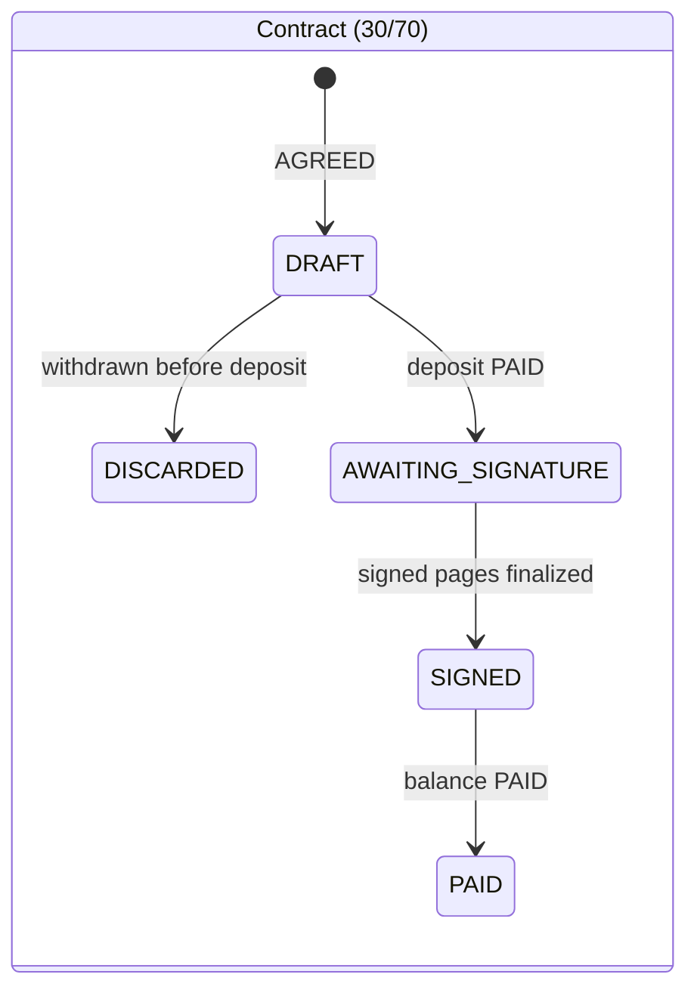
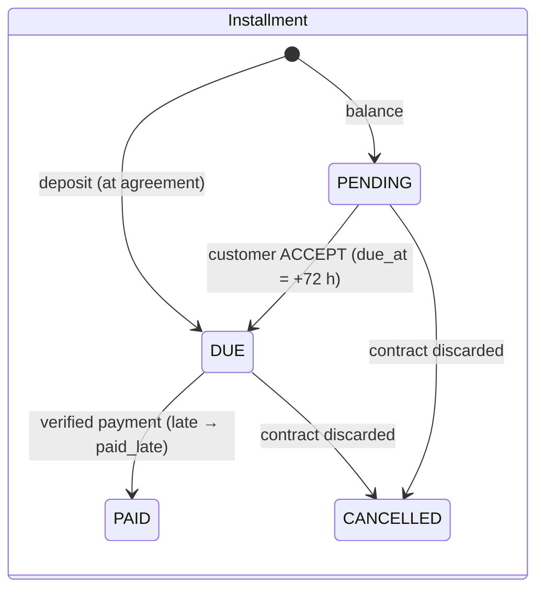
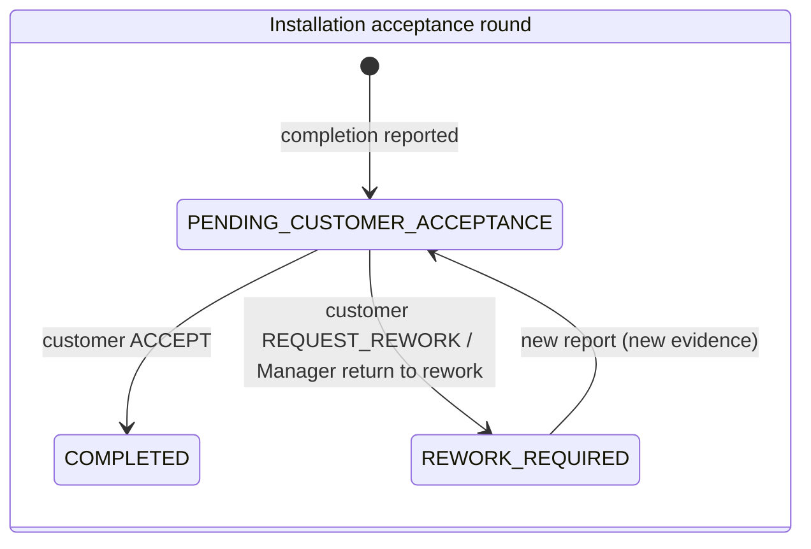
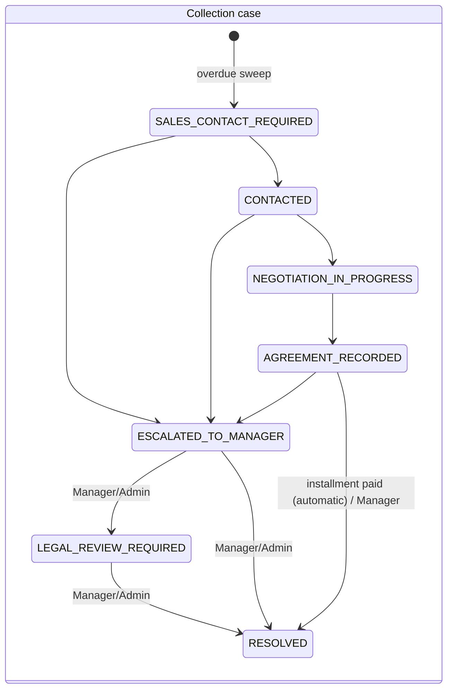

# Business workflow — installation sale with 30/70 payment (2026-11-19)

Actors: **Technician** (surveys, sells on site, installs), **Customer**, **Manager** (cash confirmation, rework coordination, legal escalation),
**Sales** (collection follow-up, read-only on contracts), **Admin** (everything Manager can + finance overview).

## 1. Happy path
```mermaid
sequenceDiagram
    autonumber
    actor T as Technician
    actor C as Customer
    actor M as Manager
    participant API as SmartSolar API
    participant P as PayOS
    T->>API: issue quotation (cart, prices frozen)
    T->>API: on-site decision AGREED
    API-->>API: contract DRAFT + deposit DUE (30%) + balance PENDING (70%)
    API-->>C: notification: contract ready to read
    C->>API: read full contract (preview)
    T->>API: open deposit payment (QR or CASH)
    alt QR
        C->>P: pay with banking app
        P->>API: verified webhook
    else Cash
        M->>API: confirm cash (amount, receipt, evidence)
    end
    API-->>API: deposit PAID → contract AWAITING_SIGNATURE
    C->>T: signs the printed contract on paper
    T->>API: start signed-page upload (page count), PUT page 1..N, finalize
    API-->>API: contract SIGNED (ready for installation)
    T->>API: record agreed installation date (may be done right after the deposit)
    API-->>API: schedule CONFIRMED, project created and assigned
    T->>API: start, evidence, equipment, completion report
    API-->>C: notification: please accept or request rework
    C->>API: ACCEPT
    API-->>API: installation COMPLETED; balance DUE (accepted + 72 h)
    C->>API: pay balance (QR in app or CASH confirmed by Manager)
    API-->>API: balance PAID → contract PAID (fully paid), ownership transfer eligible
```

## 2. Lifecycles (independent)





## 3. Rules per step
| Step | Rule |
|---|---|
| Agreement | Only the surveying technician; quotation ISSUED, current version, not expired, survey not amended, request open. Creates ONE contract (retry returns the same; DB unique index). Needs a default installation warranty option (Admin). |
| Preview | The customer sees the DRAFT 30/70 contract (full terms incl. payment and ownership clauses) before paying. |
| Withdrawal | DECLINED / REVISION_NEEDED before the deposit discards the contract (kept as history) and cancels its installments; refused while a deposit payment is open or after it was verified. A new quotation version gets its own contract at its own agreement. |
| Deposit | Exactly 30% of the frozen total; technician (on site) or customer (app); cash confirmed by Manager/Admin only. Does not make the contract PAID. |
| Paper signature | After the verified deposit only. Pages 1..N (1–50), one current file per page, JPEG/PNG/WebP (PDF allowed by `PaymentPlan:AllowPdfSignedPages`), VERIFIED SIGNED_CONTRACT_PAGE files registered by the uploader; a page may be replaced before finalizing (history kept); finalize needs no gap and re-checks every stored object; finalized = locked. No Manager review; not an e-signature. |
| Installation | Ready = deposit verified + paper finalized (contract SIGNED); plus the existing prerequisites (EVN / PCCC / structural checklist), assigned technician, valid schedule. 100% is not required. |
| Acceptance | Customer only (technician and Manager cannot accept). ACCEPT needs required prerequisites satisfied and equipment differences approved. REQUEST_REWORK / REJECT needs a reason (+ optional ACCEPTANCE_EVIDENCE). Each round keeps report, decision, decider, role, time, reason, evidence. |
| Balance | Opens at ACCEPT, due within 72 h; customer (app) or technician; late payment accepted and flagged. |
| Overdue | Collection case for Sales; no automatic extension, penalty, repossession or confiscation. |
| Legacy | Contracts created before 2026-11-19 keep their flow (100%); their pending legacy payments still settle. |
